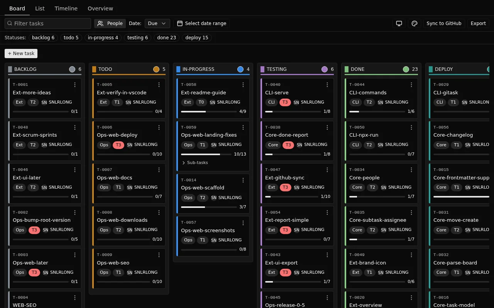
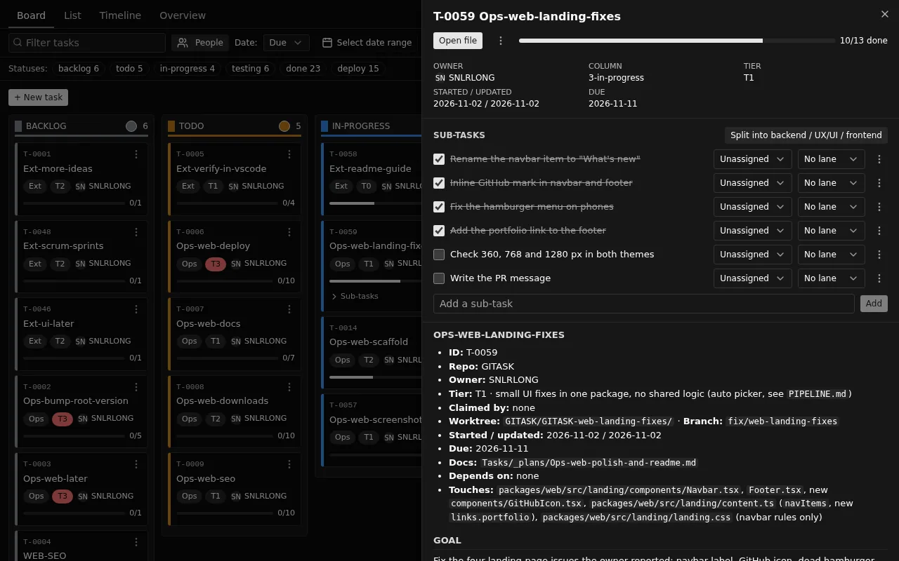

# GITASK

A Kanban board for a plain-Markdown `Tasks/` folder, inside VS Code. One Markdown file per task; **the folder is the status**. Drag a card and GITASK moves the file with `git mv`, bumps its `Started / updated` date and commits that one file. No accounts, no server: git is the identity and the history.

Built for workspaces where humans and coding agents share one board ([My-Agent-SetUp](https://github.com/vannseavlong/Agent-SetUp)).

## Getting started in 6 steps

1. **Initialize:** run **GITASK: Initialize Tasks Folder**.
2. **Create:** run **GITASK: New Task**.
3. **Move:** run **GITASK: Open Board** and drag a card to another column.
4. **Assign and split:** click the owner on a card; add `- [ ] text @person #lane` under `## Sub-tasks`.
5. **Export:** click **Export** for a report by person.
6. **Make it yours (0.6.0):** click **Add project header** for a title and logo, drag the tabs into your order, and use **+ Add status** for a new column.

Full walkthrough, including use with coding agents: [Use GITASK from install to a finished task](https://github.com/vannseavlong/GITASK/blob/main/packages/web/docs/getting-started.md).

## Use it

Open a workspace that has `Tasks/1-backlog/` (or any numbered folders under `Tasks/`). The extension activates by itself.

- **GITASK: Open Board** shows the board. Drag a card to another column to move it.
- **GITASK: New Task** creates a task from `Tasks/_TEMPLATE.md`.
- **GITASK: Initialize Tasks Folder** sets up a new project: it creates `Tasks/1-backlog` to `6-deploy` and a `_TEMPLATE.md`, then opens the board. Safe to run again; it never overwrites.

```
Tasks/
  1-backlog/ 2-todo/ 3-in-progress/ 4-testing/ 5-done/ 6-deploy/   ← columns
  _inbox/ _plans/ _TEMPLATE.md                                      ← ignored by the board
```

A task is a Markdown file. The `#` heading is the title and the `- **Key:** value` lines above the first `##` are its fields:

```markdown
# Web-login-page

- **Owner:** Sam
- **Tier:** T2 · new screen
- **Started / updated:** 2026-10-01 / 2026-10-17
```

## Make the board yours

- **Project header:** a title, subtitle and logo above every view and in reports, with your choice of alignment, size and logo position. See [Add a project title and logo](https://github.com/vannseavlong/GITASK/blob/main/packages/web/docs/project-header.md).
- **Tabs:** Overview comes first. Drag a tab, or press Alt+Left and Alt+Right on a focused tab, to reorder; your order is remembered.
- **Add status:** **+ Add status** on the board creates the next numbered status folder.
- **Create and delete:** a new task keeps you on the board and opens its detail; deleting asks in a dialog that says what will be removed.

## People, sub-tasks and reports

- **Assign:** click the owner on a card (or **+ Assign**) to pick a repo contributor. The **People** filter shows one person's tasks.
- **Sub-tasks:** under `## Sub-tasks`, write `- [ ] Build login API @sam-lee #backend`. Expand them in List, or with the **Sub-tasks** toggle on a card; add and assign in the task detail.
- **Your own fields (0.6.1):** add a `fields` list to `Tasks/gitask.json` (for example Platform: Admin Portal, App, Landing Page). Each field gets a filter button, badges on cards and rows, and a picker in the task detail and on each sub-task (`#platform:app`). See the [custom fields guide](https://github.com/vannseavlong/GITASK/blob/main/packages/web/docs/custom-fields.md).
- **Export:** the **Export** button builds a "what was done" report by person (HTML, Markdown or CSV) with a live preview. See the [report guide](https://github.com/vannseavlong/GITASK/blob/main/packages/web/docs/report.md).
- **GITASK: Sync to GitHub** (opt-in, shows a dry run first) creates issues for your tasks so assignees are notified. It does nothing until `Tasks/gitask.json` has a `github` entry; see [Docs/architecture/github.md](https://github.com/vannseavlong/GITASK/blob/main/Docs/architecture/github.md).





## Settings

| Setting | Default | What it does |
|---|---|---|
| `gitask.tasksDir` | `Tasks` | Tasks folder, relative to the workspace root |
| `gitask.autoCommit` | `true` | Commit the task file when a card is moved |
| `gitask.commitMessage` | `task({id}): {from} → {to}` | Commit message; `{id}`, `{from}`, `{to}` are replaced |

## Good to know

- A move commits only that task's file; other staged or dirty files are not touched.
- GITASK **never pushes**.
- Same engine as the command line: `npx gitask-cli board`. `npx gitask-cli serve` opens the same UI in a browser (local, token-protected).

[Source and issues](https://github.com/vannseavlong/GITASK) · MIT
